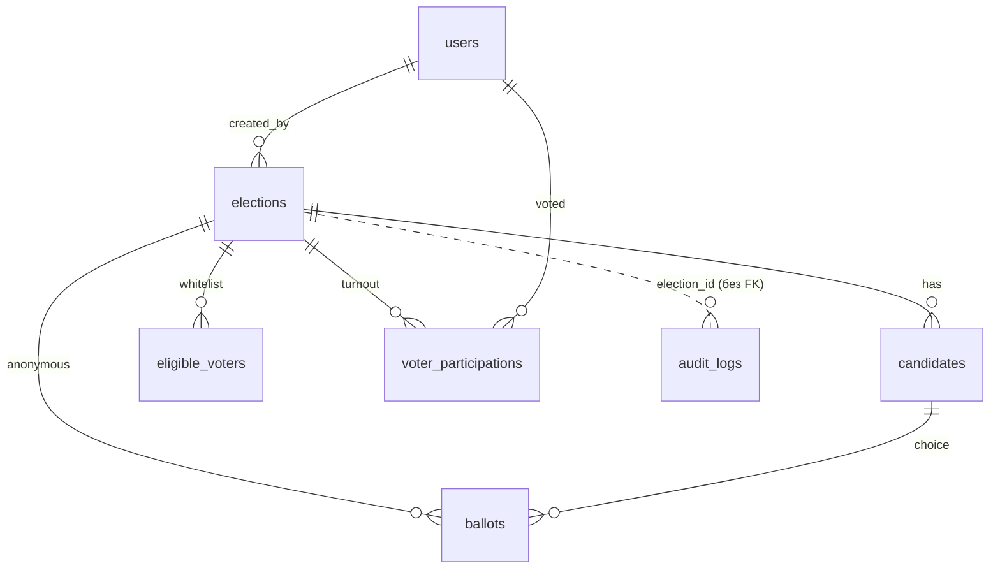

# Схема БД (PostgreSQL)

Міграції Alembic (`backend/alembic/versions`), ланцюжок:
`15533011651c` (початкові таблиці) → `6c0a7e2d9b41` (аудит, закриття, публікація) →
`7d3b9f1a5c82` (обмеження цілісності для production).

## Таблиці

| Таблиця | Призначення | Ключові обмеження |
|---|---|---|
| `users` | Користувачі (mock до Auth) | `email` UNIQUE; `role` voter/admin |
| `elections` | Голосування | `status` draft/active/closed; **CHECK `ends_at > starts_at`**; `closed_at`, `results_published`, `results_published_at`; індекс `(status, ends_at)` для таймера |
| `candidates` | Кандидати | FK `election_id`; **UNIQUE `(election_id, lower(name))`** |
| `eligible_voters` | Whitelist email | UNIQUE `(election_id, email)`; **CHECK `email = lower(email)`**; індекс по `email` |
| `voter_participations` | Факт явки (хто, без вибору) | **UNIQUE `(election_id, user_id)` `uq_user_election_vote`** — 1 голос на людину |
| `ballots` | Анонімний бюлетень | Немає `user_id` і часу; індекс `(election_id, candidate_id)` для підрахунку |
| `audit_logs` | Журнал дій (append-only) | Без FK на elections; тригер у PostgreSQL забороняє UPDATE/DELETE |

## Анонімність і межі гарантій

* `ballots` не містить користувача й часу; `voter_participations` не містить вибору;
  вони записуються в одній транзакції.
* Журнал і CSV містять лише агрегати та службові id.
* **Не гарантується** захист від адміністратора БД, який зіставляє записи за
  порядком вставки/службовими метаданими PostgreSQL (ctid, WAL), та від малих
  вибірок (одному виборцю відповідає один бюлетень). `voted_at` у
  `voter_participations` точний — доступ до цієї таблиці має бути обмежений.
  Модель загроз погоджується з QA (див. `docs/decisions.md`).

## Інваріанти (перевіряє `app.cli.validate_data` і `GET /admin/elections/{id}/integrity`)

1. Бюлетенів стільки ж, скільки участей, для кожного голосування.
2. Бюлетень посилається на кандидата свого голосування.
3. `closed` ⇔ заповнений `closed_at`; публікація можлива лише для `closed`.
4. Чернетка не має голосів.
5. Усі учасники є у whitelist (whitelist заморожений після `activate`).
6. Попередження: `active` після `ends_at` більш ніж на 2 хв (таймер відстає), <2 кандидатів у запущеному голосуванні.

## Міграція `7d3b9f1a5c82` на наявних даних

Перед додаванням обмежень вона: видаляє дублікати email у whitelist, що різняться
лише регістром, і приводить email до нижнього регістру; перейменовує кандидатів з
однаковими іменами (додає суфікс `(<8 символів id>)`). Перед production-запуском
зробіть резервну копію й прогін на копії БД. Downgrade прибирає обмеження, але не
повертає змінені дані.